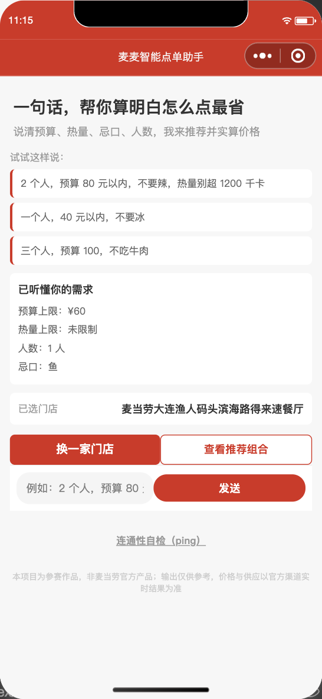
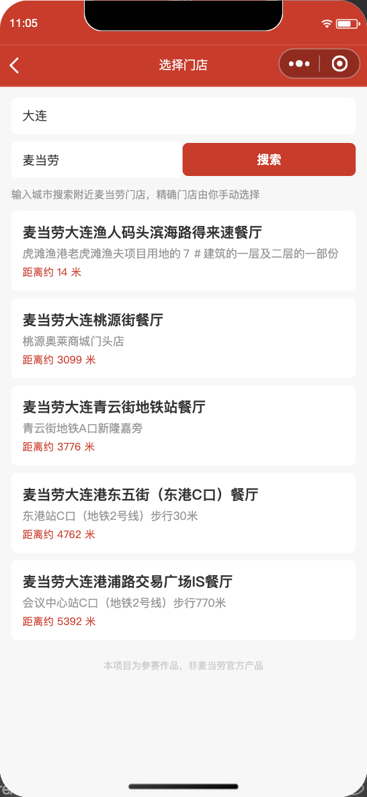
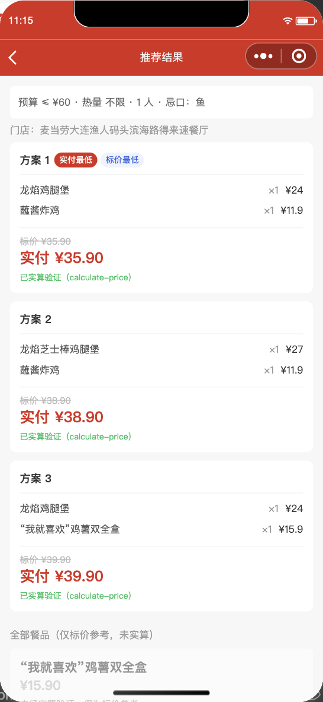
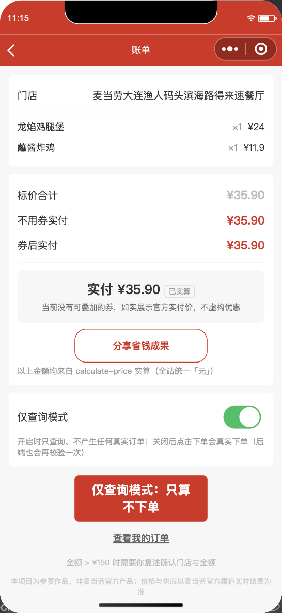

# 麦麦智能点单助手

> 麦当劳 MCP 创新赛参赛作品 · **非麦当劳官方产品**
>
> 一句话点单：预算、热量、忌口、人数，一次说清——AI 按**官方实算价**帮你选最划算的组合。

## 核心卖点

**「标价最低 ≠ 实付最低」**——我们不信标价，只信 `calculate-price` 官方实算：

| 组合 | 标价 | 实付 |
|---|---|---|
| A（无券可叠） | ¥38.50 | ¥38.50 |
| B（叠满减券） | ¥47.50 | **¥35.50** ✅ 推荐 |

推荐排序按实付价，每个推荐项带 `verified` 标记；未实算的结果一律灰显，绝不冒充实算价。

## 目标用户

- **预算敏感型**（学生 / 年轻白领）：一句话说预算，拿到「花得明白」的实付组合
- **身材管理人群**：热量上限约束 + 官方营养表匹配，「想吃麦当劳也能控卡」
- **有忌口的用户**（过敏 / 不吃某类食材）：口语化忌口自动剔除，不用逐个翻菜单
- **多人拼单场景**（宿舍 / 办公室）：人数约束生成组合推荐，账单明细一目了然
- **选择困难用户**：不用研究菜单比价，AI 直接给出三个已实算的方案

## 主流程（五页）

一句话需求 → 需求解析回显 → 选门店（城市+关键词）→ 组合推荐（官方实算）→ 账单复核 → 订单双源查询

| 截图 | 场景 |
|---|---|
|  | 首页：一句话解析（预算/忌口/人数） |
|  | 门店：大连真实门店 5 家 |
|  | 推荐：3 组合全部「已实算验证」 |
|  | 账单：实算明细 + 省钱金句卡 + 取餐方式 |

## 架构（双层，Token 零前端暴露）

```
小程序前端（微信原生，5 页 3 组件）
    │ wx.cloud.callFunction（openid 由云端注入）
云函数（微信云开发）
    ├─ mcp-proxy ──→ 麦当劳官方 MCP（https://mcp.mcd.cn）
    │    ├─ MCP_TOKEN 仅存环境变量（Bearer，白名单返回体）
    │    ├─ tools 六模块：store / menu / price / order / coupon / nutrition
    │    └─ 自检：mcp.status（35 官方工具握手验证）
    ├─ chat-parse ──→ 纯规则解析（无大模型，原文永不进提示词）
    └─ order-service ──→ 云数据库 orders（_openid 强制隔离）
```

## 安全设计（红线全落实，实测验证）

- **凭证安全**：Token 只在云函数环境变量；仓库/前端/日志零出现（已全库扫描）；401 不重试
- **提示词注入免疫**：需求解析是纯正则引擎（无 LLM），用户原文清洗（200 字截断 + 注入片段剥离）后只做字段提取，机制上无法注入
- **隐私最小化**：不收集手机号/精确位置；门店用城市+关键词搜索；openid 由云端注入强制隔离订单
- **支付安全**：默认「仅查询模式」（前端+云端双重拦截）；不代付、不模拟支付成功；金额 >¥150 强制复述确认
- **诚实展示**：无券不虚构优惠；热量未知不猜（`nutritionCoverage` 如实透出）；金额取不到显示 `--` 而非 ¥0.00

## 快速开始

1. **导入**：微信开发者工具导入本仓库（AppID 见 `project.config.json`）
2. **开通云开发**：创建环境后把 `miniprogram/app.js` 与 `cloudfunctions/*/index.js` 中的环境 ID 替换为你自己的
3. **部署云函数**：右键 `cloudfunctions/` 下三个函数 → 上传并部署（云端安装依赖）
4. **配置 Token**：按 `docs/MCP_SETUP.md` 申请并配置 `MCP_TOKEN` 环境变量 → 重新部署 mcp-proxy
5. **（重要）超时**：云开发控制台把 mcp-proxy 超时改为 **60 秒**（默认 3 秒不够组合推荐实算）
6. **无 Token 演示**：不配 Token 自动进 Mock 模式（完整流程可演示，UI 角标「演示数据」）

## 文档

- `MCP_INTEGRATION.md` — 麦当劳 MCP 集成说明（Server / 8 个 Tool / 调用流程 / 业务价值）
- `workbuddy.md` — WorkBuddy 开发上下文（本项目全程 WorkBuddy 智能体开发）
- `CONTEST_DECLARATION.md` — 参赛声明（原创性 / 合规 / 敏感信息）
- `docs/TECH_DESIGN.md` — 技术方案（含 Token 联调后的 9 条实测结论）
- `docs/MCP_SETUP.md` — MCP Token 申请与配置指引
- `docs/screenshots/` — 全流程实机截图

## 目录结构

```
miniprogram/           # 前端：5 页（index/store/recommend/checkout/order-detail）
  components/          # chat-bar / meal-card / price-tag
  utils/               # money.js（全站唯一分→元换算点）/ request.js
cloudfunctions/
  mcp-proxy/           # MCP 客户端 + tools 六模块 + Mock
  chat-parse/          # 需求解析（纯规则）
  order-service/       # 订单落库（openid 隔离）
docs/                  # 技术方案 + Token 指引 + 截图
```

## 许可与声明

MIT License（见 LICENSE）。本项目为参赛作品，非麦当劳官方产品；价格与供应以麦当劳官方渠道实时结果为准。
